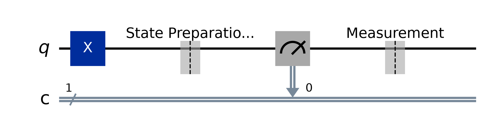

# Lab 00 — Setup and First Quantum Circuit

## Aim
To set up the Qiskit environment, build a first quantum circuit, look at its statevector, and run it on the Aer simulator.

## Theory
**Qubit.** A qubit's state is a unit vector in $\mathbb{C}^2$:

$$|\psi\rangle = \alpha|0\rangle + \beta|1\rangle, \qquad |\alpha|^2 + |\beta|^2 = 1,$$

with the basis states

```math
|0\rangle = \begin{pmatrix}1\\ 0\end{pmatrix}, \qquad |1\rangle = \begin{pmatrix}0\\ 1\end{pmatrix}.
```

**X gate.** The quantum NOT gate swaps $|0\rangle$ and $|1\rangle$:

```math
X = \begin{pmatrix}0 & 1\\ 1 & 0\end{pmatrix}.
```

**Measurement.** Measuring in the computational basis gives `0` with probability $|\alpha|^2$ and `1` with probability $|\beta|^2$ (the Born rule).

**Qiskit workflow.**
1. Build a `QuantumCircuit` from quantum and classical registers.
2. Inspect it with `Statevector`: the exact, noiseless state.
3. `transpile` the circuit for a backend and `run` it for a number of *shots*.
4. Read the `counts` histogram.

**Bit ordering.** Qiskit is *little-endian*: in a bitstring such as `"q2q1q0"`, qubit 0 is the rightmost bit. All later labs use this convention.

## Setup
```bash
python3 -m venv .venv            # Python 3.11 or newer
source .venv/bin/activate
pip install -r requirements.txt
jupyter lab                      # or open the notebooks in VS Code
```

## Circuit diagram


## Procedure
1. Install the requirements (see Setup) and open `lab.ipynb`.
2. Run the **environment check** cell and note the package versions.
3. Run the remaining cells: build the circuit, print the statevector, measure, and plot the histogram.
4. Set `APPLY_X = False` and run again.

## Parameters to try
- `APPLY_X` = `True`, `False`
- `SHOTS` = 1, 10, 1024

## Expected output
```
Statevector: [0.+0.j 1.+0.j]
Dirac form : (+0.0000)|0> + (+1.0000)|1>
Probabilities: {'1': 1.0}
Counts: {'1': 1024}
Measured |1> in all 1024 shots. Environment is ready!
```

## Observations
| S.No | APPLY_X | Statevector | Counts |
|---|---|---|---|
| 1 | True | | |
| 2 | False | | |

## Result
The Qiskit environment works, and the simulator reproduces the theoretical output of the X gate exactly.

## Viva questions
1. What is the difference between a classical bit and a qubit?
2. Why does `Statevector` need the final measurements removed?
3. What is a *shot*? Why does a deterministic circuit give the same result in every shot?
4. What does `transpile` do?
5. In Qiskit, which character of the bitstring `"101"` belongs to qubit 0?
