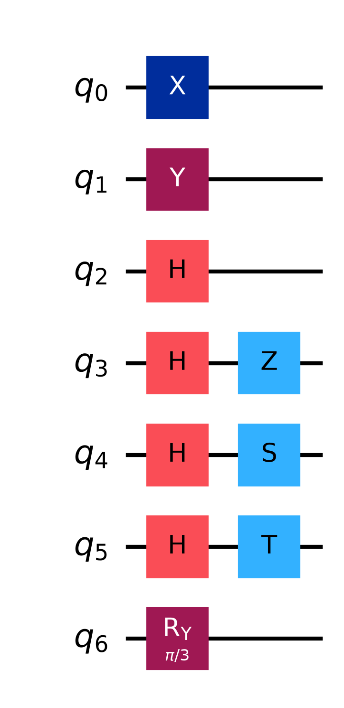
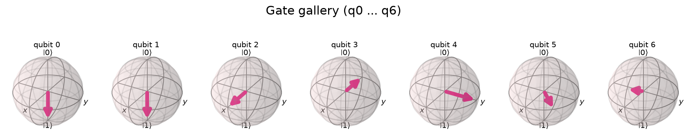

# Lab 01 — Single-Qubit Gates and the Bloch Sphere

## Aim
To study the standard single-qubit gates ($X, Y, Z, H, S, T$ and the rotations $R_x, R_y, R_z$) through their matrices, their action on basis states, and their geometry on the Bloch sphere.

## Theory
**Bloch sphere.** Ignoring global phase, every single-qubit pure state can be written as

$$|\psi\rangle = \cos\tfrac{\theta}{2}|0\rangle + e^{i\phi}\sin\tfrac{\theta}{2}|1\rangle ,$$

which is a point on the unit sphere with polar angle $\theta$ and azimuth $\phi$. $|0\rangle$ is the north pole, $|1\rangle$ the south pole, and $|\pm\rangle = (|0\rangle \pm |1\rangle)/\sqrt2$ lie on the $\pm x$ axis.

**Gates are rotations.** Every single-qubit unitary is a rotation of the Bloch sphere.

| Gate | Bloch-sphere action | $\|0\rangle \mapsto$ |
|---|---|---|
| $X$ | $\pi$ about $x$ | $\|1\rangle$ |
| $Y$ | $\pi$ about $y$ | $i\|1\rangle$ |
| $Z$ | $\pi$ about $z$ | $\|0\rangle$ |
| $H$ | $\pi$ about $(x+z)/\sqrt2$ | $\|+\rangle$ |
| $S$ | $\pi/2$ about $z$ | $\|0\rangle$ |
| $T$ | $\pi/4$ about $z$ | $\|0\rangle$ |
| $R_y(\theta)$ | $\theta$ about $y$ | $\cos\frac\theta2\|0\rangle+\sin\frac\theta2\|1\rangle$ |

**Matrices.**

```math
X = \begin{pmatrix}0 & 1\\ 1 & 0\end{pmatrix}, \quad
Y = \begin{pmatrix}0 & -i\\ i & 0\end{pmatrix}, \quad
Z = \begin{pmatrix}1 & 0\\ 0 & -1\end{pmatrix}, \quad
H = \frac{1}{\sqrt2}\begin{pmatrix}1 & 1\\ 1 & -1\end{pmatrix}
```

```math
S = \begin{pmatrix}1 & 0\\ 0 & i\end{pmatrix}, \quad
T = \begin{pmatrix}1 & 0\\ 0 & e^{i\pi/4}\end{pmatrix}, \quad
R_y(\theta) = \begin{pmatrix}\cos\frac\theta2 & -\sin\frac\theta2\\ \sin\frac\theta2 & \cos\frac\theta2\end{pmatrix}
```

**Useful identities.** $HZH = X$, $HXH = Z$, $S^2 = Z$, $T^2 = S$, $XZ = -iY$, $H^2 = I$.

## Circuit diagram
Gate gallery: qubit $i$ gets the $i$-th gate from the table, applied to $|0\rangle$. The phase gates are applied after an $H$.





## Procedure
1. Open `lab.ipynb` and run all cells.
2. Write down the printed matrix of each gate.
3. Note the output state of each qubit in the gallery and find it on the Bloch-sphere plot.
4. Change `AXIS` and `THETA` and watch qubit 6 move.

## Parameters to try
- `AXIS` = `"x"`, `"y"`, `"z"`
- `THETA` = `0`, `np.pi/4`, `np.pi/2`, `np.pi`, `2*np.pi` (what happens at $2\pi$?)

## Expected output
```
q[0]  X        |0> -> (+0.0000)|0> + (+1.0000)|1>
q[1]  Y        |0> -> (+0.0000)|0> + (+1.0000j)|1>
q[2]  H        |0> -> (+0.7071)|0> + (+0.7071)|1>
q[3]  H, Z     |0> -> (+0.7071)|0> + (-0.7071)|1>
q[4]  H, S     |0> -> (+0.7071)|0> + (+0.7071j)|1>
q[5]  H, T     |0> -> (+0.7071)|0> + (+0.5000 + 0.5000j)|1>
q[6]  Ry(θ)    |0> -> (+0.8660)|0> + (+0.5000)|1>

HZH = X  : True
...
All gate matrices, identities and output states verified.
```

## Observations
| S.No | Gate(s) | Output state | Bloch vector direction |
|---|---|---|---|
| 1 | X | | |
| 2 | Y | | |
| 3 | H | | |
| 4 | H, Z | | |
| 5 | H, S | | |
| 6 | H, T | | |
| 7 | R_y(θ) | | |

## Result
The simulated matrices and output states match theory, and every gate acts as the expected rotation of the Bloch sphere.

## Viva questions
1. Why do $X$ and $Y$ applied to $|0\rangle$ give the same point on the Bloch sphere, even though the states differ?
2. Why does $Z$ have no visible effect on $|0\rangle$?
3. Prove $HZH = X$ by multiplying the matrices.
4. $R_z(2\pi) = -I$. Why can't this sign be observed?
5. Why is the $T$ gate important for universal quantum computing?
6. Which gates are Hermitian? Which are their own inverses?
