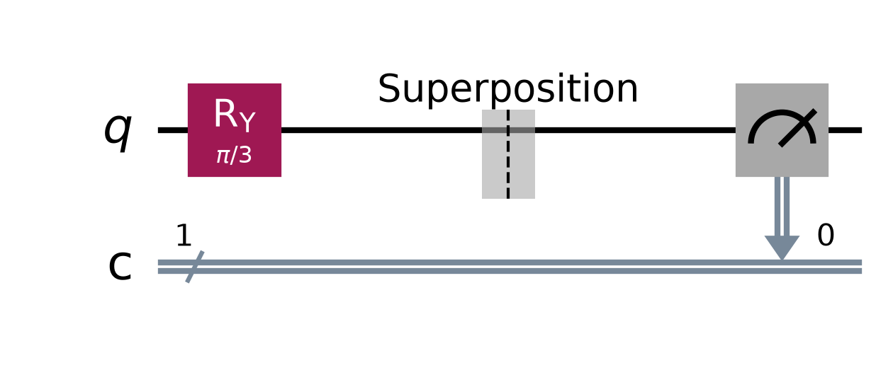
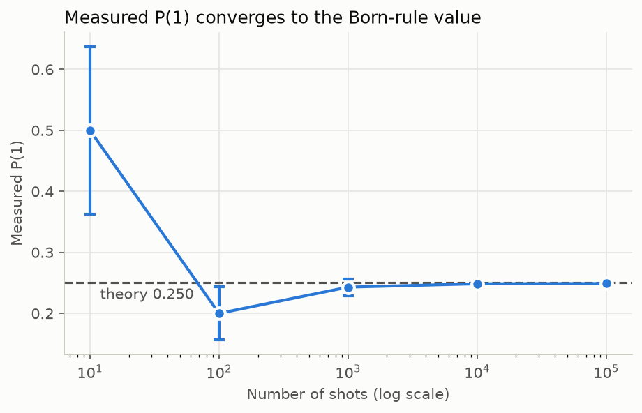

# Lab 02 — Superposition and Measurement

## Aim
To prepare a single-qubit superposition, check the Born rule by repeated measurement, study how statistical error shrinks with the number of shots, and see how the measurement basis changes the outcome.

## Theory
**Superposition.** The rotation $R_y(\theta)$ takes $|0\rangle$ to

$$|\psi(\theta)\rangle = \cos\tfrac{\theta}{2}\thinspace |0\rangle + \sin\tfrac{\theta}{2}\thinspace |1\rangle .$$

**Born rule.** Measuring in the computational ($Z$) basis gives

$$P(0) = \cos^2\tfrac{\theta}{2}, \qquad P(1) = \sin^2\tfrac{\theta}{2}.$$

A single measurement gives only one random bit. Probabilities can only be *estimated*, by repeating the experiment for $N$ shots.

**Sampling error.** The count of `1`s follows a binomial distribution, so the estimate $\hat p = n_1/N$ has standard error

$$\sigma = \sqrt{\frac{P(1)\thinspace (1-P(1))}{N}} \thickspace \propto \thickspace \frac{1}{\sqrt N}.$$

Getting one more decimal digit of accuracy takes about 100× more shots.

**Measurement basis.** $|+\rangle = (|0\rangle + |1\rangle)/\sqrt2$ gives 50/50 results in the $Z$ basis. But it is an eigenstate of $X$, so measuring in the $X$ basis always gives the same answer. Hardware can only measure in $Z$, so an $X$-basis measurement is done by applying $H$ first.

## Circuit diagram




## Procedure
1. Open `lab.ipynb`, set `THETA`, and run all cells.
2. Write down the theoretical $P(0)$ and $P(1)$.
3. Fill in the shots table from the printed output. Check that the error shrinks roughly as $1/\sqrt N$.
4. Compare the $Z$-basis and $X$-basis results for $|+\rangle$.

## Parameters to try
| `THETA` | State | P(1) |
|---|---|---|
| `0` | $\|0\rangle$ | 0 |
| `np.pi/3` | default | 0.25 |
| `np.pi/2` | $\|+\rangle$ | 0.5 |
| `2*np.pi/3` | | 0.75 |
| `np.pi` | $\|1\rangle$ | 1 |

## Expected output (`THETA = π/3`)
```
State: (+0.8660)|0> + (+0.5000)|1>
Born rule: P(0) = 0.7500, P(1) = 0.2500
   shots | count(1) | P(1) measured |  |error| | std. error
      10 |        5 |        0.5000 |   0.2500 |     0.1369
     100 |       20 |        0.2000 |   0.0500 |     0.0433
    1000 |      243 |        0.2430 |   0.0070 |     0.0137
   10000 |     2485 |        0.2485 |   0.0015 |     0.0043
  100000 |    24892 |        0.2489 |   0.0011 |     0.0014
|+> measured in Z basis: {'0': 50337, '1': 49663}
|+> measured in X basis: {'0': 100000}
```
Exact counts depend on `SEED`.

## Observations
| S.No | Shots N | Count of 1 | Measured P(1) | Theoretical P(1) | \|Error\| | σ |
|---|---|---|---|---|---|---|
| 1 | 10 | | | | | |
| 2 | 100 | | | | | |
| 3 | 1 000 | | | | | |
| 4 | 10 000 | | | | | |
| 5 | 100 000 | | | | | |

## Result
The measured probability converged to $\sin^2(\theta/2)$, with an error that shrinks as $1/\sqrt N$. The same state $|+\rangle$ gave random results in the $Z$ basis and a deterministic result in the $X$ basis.

## Viva questions
1. Why can't one measurement reveal $\alpha$ and $\beta$?
2. How many shots are needed to estimate $P(1)$ to within ±0.001 (1σ) when $P(1) = 0.5$?
3. Does measuring $|\psi\rangle$ change the state? What is the state after an outcome of `1`?
4. $|+\rangle$ and $|-\rangle$ give the same $Z$-basis statistics. How can you tell them apart?
5. Why does measuring in the $X$ basis mean applying $H$ before a $Z$ measurement?
