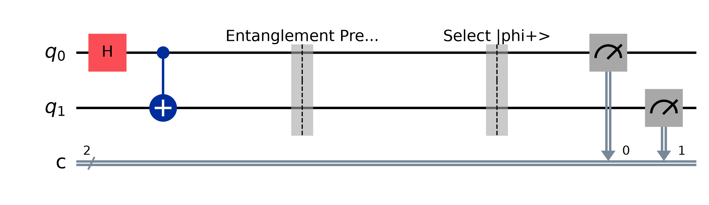

# Lab 03 — Entanglement and Bell States

## Aim
To prepare the four Bell states, confirm their statevectors, show that each qubit alone is maximally mixed, and measure their perfect correlations in both the $Z$ and $X$ bases.

## Theory
**Creating entanglement.** A Hadamard followed by a CNOT turns a product state into an entangled one:

$$|00\rangle \xrightarrow{H\otimes I} \tfrac{1}{\sqrt2}(|0\rangle + |1\rangle)|0\rangle \xrightarrow{\text{CNOT}} \tfrac{1}{\sqrt2}(|00\rangle + |11\rangle) = |\Phi^+\rangle .$$

**The Bell basis.** Applying a local $X$ and/or $Z$ to one qubit gives the other three Bell states. Together they form an orthonormal basis of two-qubit states:

| State | Vector ($\|q_0 q_1\rangle$) | Extra gates | $\langle ZZ\rangle$ | $\langle XX\rangle$ |
|---|---|---|---|---|
| $\|\Phi^+\rangle$ | $(\|00\rangle + \|11\rangle)/\sqrt2$ | — | +1 | +1 |
| $\|\Phi^-\rangle$ | $(\|00\rangle - \|11\rangle)/\sqrt2$ | $Z$ on q0 | +1 | −1 |
| $\|\Psi^+\rangle$ | $(\|01\rangle + \|10\rangle)/\sqrt2$ | $X$ on q1 | −1 | +1 |
| $\|\Psi^-\rangle$ | $(\|01\rangle - \|10\rangle)/\sqrt2$ | $X$ on q1, $Z$ on q0 | −1 | −1 |

**Entanglement.** A Bell state cannot be written as $|a\rangle \otimes |b\rangle$. Tracing out one qubit leaves

$$\rho_{q_0} = \operatorname{Tr}_{q_1} |\Phi^+\rangle\langle\Phi^+| = \tfrac{I}{2}, \qquad \operatorname{Tr}(\rho^2) = \tfrac12 ,$$

which is a maximally mixed state. Each qubit on its own is completely random. All of the information is in the correlations.

**Correlations in every basis.** The correlator $E = P(\text{same}) - P(\text{different})$ is $\pm1$ in *both* the $Z$ and $X$ bases. A classical mixture of $|00\rangle$ and $|11\rangle$ is perfectly correlated in $Z$ but gives $E = 0$ in $X$. That difference is what makes entanglement special.

## Circuit diagram
The diagram is for `BELL = "phi+"`. For the other states the gates from the table appear in the "Select" section.



## Procedure
1. Open `lab.ipynb`, set `BELL`, and run all cells.
2. Write down the statevector, the reduced density matrix of q0, and its purity.
3. Write down the $Z$-basis and $X$-basis counts and the correlators.
4. Repeat for all four Bell states (the verification cell prints a summary table).

## Parameters to try
`BELL` = `"phi+"`, `"phi-"`, `"psi+"`, `"psi-"`.

## Expected output (`BELL = "phi+"`)
```
Statevector (|q1 q0> = 00, 01, 10, 11): [0.7071+0.j 0.+0.j 0.+0.j 0.7071+0.j]
Reduced density matrix of q0:
 [[0.5 0. ]
  [0.  0.5]]
Purity Tr(rho^2) of q0: 0.5

|phi+> Z basis: {'00': ~2048, '11': ~2048} -> <ZZ> = +1.000
|phi+> X basis: {'00': ~2048, '11': ~2048} -> <XX> = +1.000

state  |   <ZZ> |   <XX> | purity(q0)
phi+   |  +1.00 |  +1.00 | 0.500
phi-   |  +1.00 |  -1.00 | 0.500
psi+   |  -1.00 |  +1.00 | 0.500
psi-   |  -1.00 |  -1.00 | 0.500
```

## Observations
| S.No | Bell state | Z-basis counts | ⟨ZZ⟩ | X-basis counts | ⟨XX⟩ | Purity of q0 |
|---|---|---|---|---|---|---|
| 1 | Φ⁺ | | | | | |
| 2 | Φ⁻ | | | | | |
| 3 | Ψ⁺ | | | | | |
| 4 | Ψ⁻ | | | | | |

## Result
All four Bell states were prepared with the expected statevectors. They showed perfect ($\pm1$) correlations in both bases, and each single qubit was maximally mixed (purity 0.5).

## Viva questions
1. Prove that $|\Phi^+\rangle$ cannot be written as a product state.
2. Why is each qubit of a Bell pair completely random even though the pair is in a pure state?
3. How would you tell $|\Phi^+\rangle$ from a 50/50 classical mixture of $|00\rangle$ and $|11\rangle$ experimentally?
4. Can entanglement be used to send a message faster than light? Why not?
5. Which Bell state is the *singlet*? Why is it anti-correlated in every basis?
6. Which circuit maps each Bell state back to a computational basis state? (Hint: see Labs 04 and 05.)
