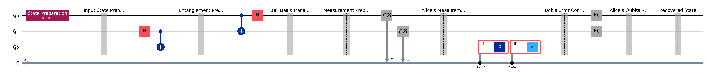

# Lab 04 — Quantum Teleportation

## Aim
To teleport an arbitrary single-qubit state $|\psi\rangle = \alpha|0\rangle + \beta|1\rangle$ from Alice to Bob using one shared Bell pair and two classical bits, and to verify that Bob recovers $|\psi\rangle$ with fidelity 1.

## Theory
Alice holds $|\psi\rangle$ on `q[0]`. Alice (`q[1]`) and Bob (`q[2]`) share the Bell pair

$$|\Phi^+\rangle = \tfrac{1}{\sqrt2}(|00\rangle + |11\rangle).$$

Alice applies a CNOT from `q[0]` to `q[1]` and then a Hadamard on `q[0]`. This rotates her two qubits into the Bell basis, and the three-qubit state becomes

$$\tfrac12 \sum_{m_0,m_1\in\{0,1\}} |m_0 m_1\rangle \otimes X^{m_1} Z^{m_0}\,|\psi\rangle .$$

When Alice measures, she gets one of the four outcomes $m_0 m_1$ with probability $1/4$. Bob's qubit is then left in $X^{m_1}Z^{m_0}|\psi\rangle$. Alice sends the two bits to Bob over a classical channel, and Bob undoes the distortion:

| $m_0\,m_1$ | Bob's qubit before correction | Correction |
|---|---|---|
| 00 | $\alpha\|0\rangle + \beta\|1\rangle$ | $I$ |
| 01 | $\beta\|0\rangle + \alpha\|1\rangle$ | $X$ |
| 10 | $\alpha\|0\rangle - \beta\|1\rangle$ | $Z$ |
| 11 | $\beta\|0\rangle - \alpha\|1\rangle$ | $X$ then $Z$ |

This does not send anything faster than light: until the two classical bits arrive, Bob's qubit is maximally mixed. The no-cloning theorem also holds, because Alice's measurement destroys her copy of $|\psi\rangle$.

## Circuit diagram


## Procedure
1. Open `lab.ipynb` and set `ALPHA`, `BETA` in the **Parameters** cell.
2. Run all cells.
3. **Step 2** prints Bob's state for each of the four measurement outcomes, before and after correction.
4. **Step 3** builds the full dynamic circuit: mid-circuit measurement plus `if_test` corrections on Bob's qubit.
5. **Step 4** simulates one run and compares Bob's final state with Alice's input.
6. **Step 5** appends $U_\psi^\dagger$ to Bob's qubit and measures it over 1024 shots. Bob must read `0` in every shot.

## Parameters to try
| `ALPHA` | `BETA` | State |
|---|---|---|
| 1 | 0 | $\|0\rangle$ |
| 0 | 1 | $\|1\rangle$ |
| 1 | 1 | $\|+\rangle$ |
| 1 | 1j | $\|{+i}\rangle$ |
| 0.6 | 0.8 | default |
| 0.3+0.4j | 0.5 | arbitrary complex |

## Expected output
```
m0 m1 = 00 | Bob before: (+0.6000)|0> + (+0.8000)|1> | corrections: none       | ... | fidelity = 1.000000
m0 m1 = 01 | Bob before: (+0.8000)|0> + (+0.6000)|1> | corrections: X          | ... | fidelity = 1.000000
m0 m1 = 10 | Bob before: (+0.6000)|0> + (-0.8000)|1> | corrections: Z          | ... | fidelity = 1.000000
m0 m1 = 11 | Bob before: (-0.8000)|0> + (+0.6000)|1> | corrections: X then Z   | ... | fidelity = 1.000000

Shots where Bob's qubit was NOT restored: 0 / 1024
Teleportation successful for all outcomes!
```
The four Alice outcomes each appear in roughly 25% of the shots.

## Observations
| S.No | α | β | Alice's outcome (m0 m1) | Bob's correction | Bob's output state | Fidelity |
|---|---|---|---|---|---|---|
| 1 | | | | | | |
| 2 | | | | | | |
| 3 | | | | | | |

## Result
For every input state and all four measurement outcomes, Bob's corrected qubit matched Alice's input with fidelity 1.

## Viva questions
1. Why does teleportation need two classical bits? Could one bit be enough?
2. Does teleportation copy the state? How is the no-cloning theorem respected?
3. Can teleportation send information faster than light? Explain using Bob's reduced density matrix before the classical bits arrive.
4. Why is the X correction controlled by `q[1]`, and the Z correction by `q[0]`?
5. What happens if Alice and Bob share $|\Psi^-\rangle$ instead of $|\Phi^+\rangle$?
6. Why is it safe to reset `q[0]` and `q[1]` at the end, but not `q[2]`?
