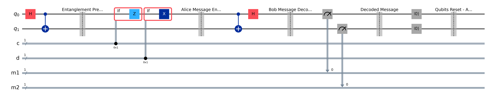

# Lab 05 — Superdense Coding

## Aim
To send two classical bits from Alice to Bob by sending only **one** qubit, using a Bell pair they shared in advance.

## Theory
Alice (`q[0]`) and Bob (`q[1]`) start out sharing $|\Phi^+\rangle = \tfrac{1}{\sqrt2}(|00\rangle + |11\rangle)$.
To send the message $dc$, Alice applies $Z^{d}X^{c}$ to her qubit only. Each choice turns the pair into a different Bell state:

| Message $dc$ | Alice applies | Shared state |
|---|---|---|
| 00 | $I$ | $\|\Phi^+\rangle = (\|00\rangle + \|11\rangle)/\sqrt2$ |
| 01 | $X$ | $\|\Psi^+\rangle = (\|01\rangle + \|10\rangle)/\sqrt2$ |
| 10 | $Z$ | $\|\Phi^-\rangle = (\|00\rangle - \|11\rangle)/\sqrt2$ |
| 11 | $ZX$ | $\|\Psi^-\rangle = (\|01\rangle - \|10\rangle)/\sqrt2$ |

The four Bell states are orthonormal, so Bob can tell them apart perfectly. Alice sends her qubit to Bob. Bob applies a CNOT (`q[0]`→`q[1]`) and then a Hadamard on `q[0]`, which maps each Bell state to a computational basis state: `q[0]` gives back $d$ and `q[1]` gives back $c$.

Superdense coding is the reverse of teleportation (Lab 04):
- Teleportation: 1 ebit + 2 classical bits → 1 qubit transferred.
- Superdense coding: 1 ebit + 1 qubit sent → 2 classical bits transferred.

## Circuit diagram
The diagram below is for `MESSAGE = "11"` (both X and Z switched on). For other messages the matching gates are left out.



## Procedure
1. Open `lab.ipynb` and set `MESSAGE` in the **Parameters** cell.
2. Run all cells. The notebook prints which gates are switched on, then runs the circuit for 1024 shots and plots the histogram.
3. Check that the decoded message equals the one sent.
4. The verification cell repeats the experiment for all four messages.

## Parameters to try
`MESSAGE` = `"00"`, `"01"`, `"10"`, `"11"`.

## Expected output
```
Z gate: ACTIVATED
X gate: ACTIVATED
Counts: {'11': 1024}

Message sent: 11
Bob decoded : 11
Correct     : True

sent 00 -> received {'00': 1024}
sent 01 -> received {'01': 1024}
sent 10 -> received {'10': 1024}
sent 11 -> received {'11': 1024}
```
The decoding is deterministic: every shot returns the message that was sent.

## Observations
| S.No | Message sent | Gates applied by Alice | Bell state | Measured counts | Decoded message |
|---|---|---|---|---|---|
| 1 | 00 | | | | |
| 2 | 01 | | | | |
| 3 | 10 | | | | |
| 4 | 11 | | | | |

## Result
All four 2-bit messages were sent with a single qubit and decoded correctly in 100% of the shots.

## Viva questions
1. Why can't Alice send two classical bits in one qubit without pre-shared entanglement? (Holevo bound)
2. Why are the four Bell states perfectly distinguishable?
3. Write the operator that Bob's CNOT followed by H implements, and show that it maps $|\Psi^-\rangle$ to $|11\rangle$.
4. What happens if Eve intercepts only Alice's qubit? What can she learn?
5. Compare the resources used in superdense coding and in teleportation.
